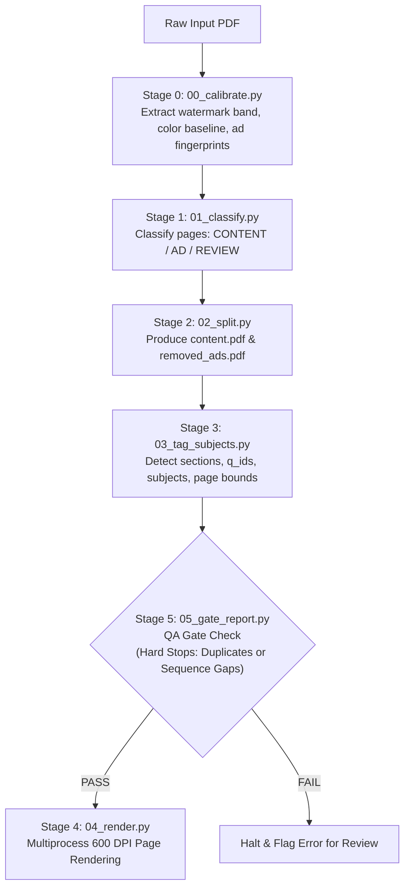

# Careers360 JEE Mains Even-Years (2018–2026) PYQ Pipeline (Stage 1)

[](https://www.python.org/)
[](https://pymupdf.readthedocs.io/)
[](https://git-lfs.github.com/)
[](output/)

Comprehensive automated pipeline and complete dataset for **Stage 1 (Ad Stripping, Question Splitting, Indexing, and Page Rendering)** of Careers360 JEE Mains PYQ papers across all even years from 2018 to 2026.

---

## 📌 Executive Summary

This repository contains the end-to-end processing pipeline, raw input PDFs, audited output artifacts, and consolidated deliverables for 5 even-year JEE Mains papers. The pipeline programmatically segregates authentic exam content from promotional and advertising insertions, tags every question with section and subject metadata, enforces strict zero-defect gate checks, and generates high-resolution 600 DPI page scans for downstream extraction.

### Core Pipeline Results

| Exam Paper | Total Pages | Content Pages | Ad Pages Removed | Sections | Questions | QA Gate Status |
|---|:---:|:---:|:---:|:---:|:---:|:---:|
| **JEE Main 2018** | 393 | 323 | 70 | 9 | 270 | **PASS** (0 dups, 1→N clean) |
| **JEE Main 2020 (Jan)** | 544 | 543 | 1 | 18 | 450 | **PASS** (0 dups, 1→N clean) |
| **JEE Main 2022 (June)** | 1004 | 908 | 96 | 36 | 1080 | **PASS** (0 dups, 1→N clean) |
| **JEE Main 2024 (April)** | 764 | 763 | 1 | 30 | 900 | **PASS** (0 dups, 1→N clean) |
| **JEE Main 2026 (Jan)** | 593 | 582 | 11 | 30 | 750 | **PASS** (0 dups, 1→N clean) |
| **TOTAL** | **3,298** | **3,119** | **179** | **123** | **3,450** | **100% GATED PASS** |

*(Note: The 5-page summary document `JEE Main Previous 10 Year Questions with Detailed Solutions (2017-2026)` was audited and excluded as it is an index summary rather than a test paper).*

---

## 📂 Repository Structure

```text
├── .gitattributes                     # Git LFS configuration for large deliverables
├── .gitignore                        # Standard Python, OS, and environment ignores
├── README.md                         # Project documentation and specifications
├── progress.md                       # Comprehensive engineering audit and execution log
│
├── careers360-pdf-pipeline/          # Core Stage 1 extraction pipeline
│   └── careers360-pdf-pipeline/
│       ├── 00_calibrate.py           # Stage 0: Derives document watermark/color profile
│       ├── 01_classify.py            # Stage 1: Classifies pages into CONTENT vs AD
│       ├── 02_split.py               # Stage 2: Generates content.pdf & removed_ads.pdf
│       ├── 03_tag_subjects.py        # Stage 3: Tags question spans, subjects, and shifts
│       ├── 04_render.py              # Stage 4: High-DPI parallel page rendering (600 DPI)
│       ├── 05_gate_report.py         # Stage 5: Zero-defect validation gate
│       ├── jeelib.py                 # Core domain logic, regex heuristics, and PDF tools
│       ├── run_all.py                # Pipeline orchestrator
│       ├── test_jeelib.py            # Offline unit tests
│       ├── profiles/                 # Format profiles (e.g., careers360.json)
│       └── reference_output/         # Golden reference run for regression testing
│
├── new_index_csvs/                   # Corrected shift/paper metadata index files
├── _backup_before_paper_label_fix/   # Safety snapshots prior to label corrections
├── jee_mains_even_years_deliverables.zip  # Consolidated deliverable archive (Git LFS)
│
├── JEE Main 2018...pdf               # Raw input: 2018 Official Question Papers
├── JEE Main January 2020...pdf       # Raw input: 2020 Jan Official Question Papers
├── JEE Main 2022 June...pdf          # Raw input: 2022 June Official Question Papers
├── JEE MAIN 2024 April...pdf         # Raw input: 2024 April Official Question Papers
├── JEE Main 2026 January...pdf       # Raw input: 2026 Jan Official Question Papers
│
└── output/                           # Full generated deliverables per year
    ├── 2018/                         # 2018 deliverables, audit logs, and rendered pages
    ├── 2020_jan/                     # 2020 Jan deliverables and rendered pages
    ├── 2022_june/                    # 2022 June deliverables and rendered pages
    ├── 2024_april/                   # 2024 April deliverables and rendered pages
    ├── 2026_jan/                     # 2026 Jan deliverables and rendered pages
    └── render_all.log                # Master rendering execution log
```

---

## ⚙️ Architecture & Pipeline Stages



### Pipeline Script Workflow

1. **`00_calibrate.py` (Calibration)**:
   Extracts document-specific statistics (watermark geometry, vector graphic thresholds, background color signatures) to prevent publisher layout differences from corrupting content detection.
2. **`01_classify.py` (Classification)**:
   Classifies every page as `CONTENT`, `AD`, or `REVIEW` with clear rationale logged to `classification_log.csv`.
3. **`02_split.py` (PDF Splitting)**:
   Extracts `content.pdf` (clean exam pages) and `removed_ads.pdf` (audit archive of all removed non-content pages), along with `page_map.csv`.
4. **`03_tag_subjects.py` (Subject & Question Indexing)**:
   Scans text and headers to map question numbers (`q_no`), sections, subjects (`Physics`, `Chemistry`, `Mathematics`), shift dates, and page ranges into `questions_index.csv` and `sections.json`.
5. **`05_gate_report.py` (Pre-Render QA Gate)**:
   Executed **before** rendering to guarantee zero duplicate question IDs and ensure every section has continuous $1 \to N$ question ordering.
6. **`04_render.py` (High-Resolution Rendering)**:
   Uses worker pools to render content and removed pages as lossless 600 DPI PNGs (`pages/` and `removed/`).

---

## 📦 Deliverables Specification

Each folder under `output/<year>/` contains:
- `content.pdf`: Sanitized PDF containing only question paper pages.
- `removed_ads.pdf`: Audit PDF containing all removed advertisement and promotional pages.
- `questions_index.csv`: Master question index with `q_id`, `section_index`, `paper`, `subject_label`, `q_no`, and page boundaries.
- `page_map.csv`: Mapping from content page numbers back to original document page numbers.
- `sections.json`: Structured JSON catalog of all paper sections and question counts.
- `profile.json`: Document calibration profile.
- `stage1_gate_report.json`: QA gate validation report.
- `pages/*.png`: 600 DPI rendered master content page images.
- `removed/*.png`: 600 DPI rendered audit images of removed pages.

The consolidated zip file `jee_mains_even_years_deliverables.zip` (~301 MB, tracked via Git LFS) bundles the core PDFs and indexes across all 5 years for handoff.

---

## 🚀 Setup & Execution Guide

### 1. Requirements

- Python 3.10+ (tested on Python 3.12.4)
- Dependencies: `pymupdf`, `psutil`, `numpy`
- Git LFS (for large binary deliverables)

```bash
git lfs install
pip install -r careers360-pdf-pipeline/careers360-pdf-pipeline/requirements.txt
```

### 2. Running Unit Tests

```bash
cd careers360-pdf-pipeline/careers360-pdf-pipeline/
python test_jeelib.py
```

### 3. Running the Pipeline

To run on a paper without rendering (fast preview & gate check in ~40 seconds):
```bash
python run_all.py "JEE Main 2018 Official Question Papers With Detailed Solutions_1789996814119.pdf" -o output/2018 --skip-render
```

To run full pipeline with 600 DPI high-resolution rendering:
```bash
python run_all.py "JEE Main 2018 Official Question Papers With Detailed Solutions_1789996814119.pdf" -o output/2018 --dpi 600
```

---

## 🔒 Quality Assurance & Verification

- **100% Gate Clearance**: Every paper passed `05_gate_report.py` validation with 0 duplicate question IDs and full section completeness.
- **Audited Ad Removal**: All 179 stripped pages were verified to ensure zero loss of genuine question or answer content.
- **Shift & Paper Label Correction**: Audited against `new_index_csvs/` to ensure all shift names (e.g. 2022 June multi-shift labels) match official exam dates.